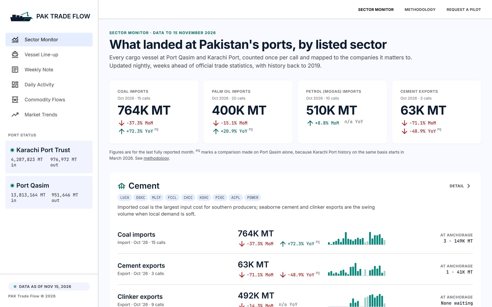
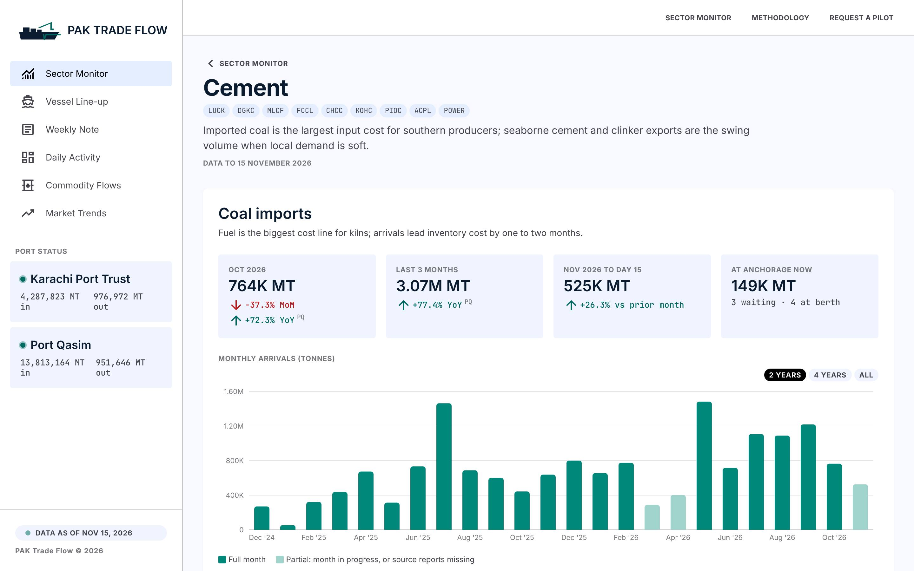
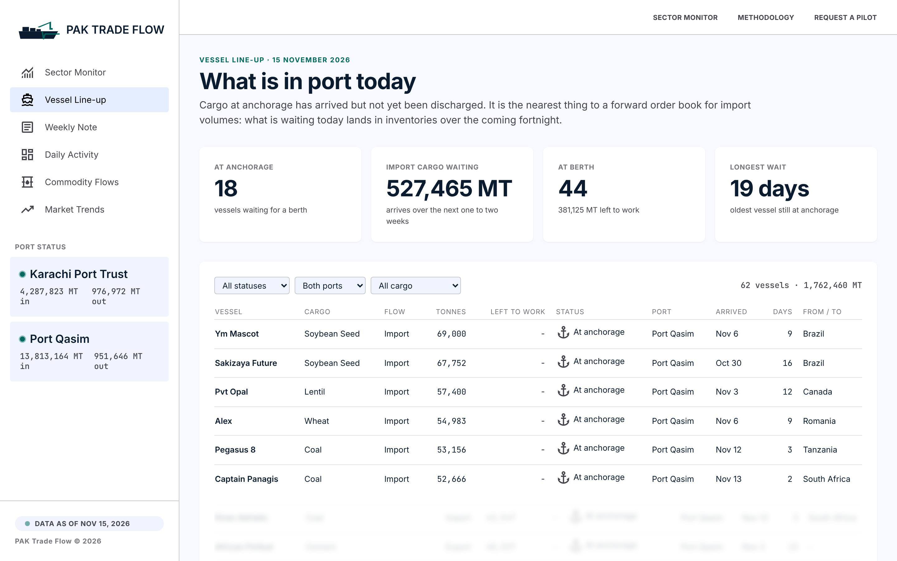
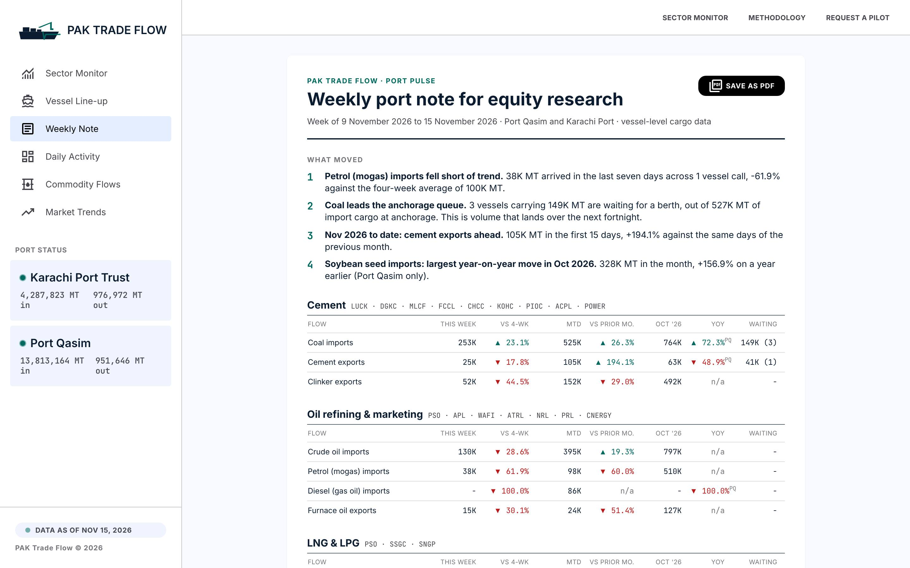

# PAK Trade Flow

**Port cargo data for Pakistan equity research.** Every vessel call at Port Qasim (PQ) and Karachi Port (KPT), counted once and mapped to the listed sectors it matters to. Updated nightly, with history back to 2019.

## What it does & the problem it solves

Port Qasim Authority and Karachi Port Trust each publish a daily statement of the vessels in port: what each carries, how much, where it came from and where it is berthed. Almost all of Pakistan's bulk trade in coal, fuels, edible oil, oilseeds, fertilizer, steel and cement crosses those two ports, but the statements are PDFs in inconsistent layouts, and a vessel is repeated for every day it stays in port.

A companion ETL pipeline parses those statements every night and follows each vessel from arrival to departure, so its cargo is counted **once**. This app turns that record into the questions an equity analyst asks:

- How much coal, palm oil, petrol or steel coil arrived last month, and how does that compare with the month before and a year earlier?
- What is waiting at anchorage right now, i.e. what lands in inventories over the next fortnight?
- Where is the cargo coming from, and which vessels brought it?

Official trade statistics and industry releases arrive two to six weeks after month end. A vessel appears here the day after it reaches port.

**Who it's for:** sell-side and buy-side analysts covering cement, energy, fertilizer, steel, chemicals and consumer staples.

## Live Demo

**[ 🔗 https://pak-trade-flow.vercel.app/ ]**

A sample of the weekly note is checked in at [`docs/sample-weekly-note.pdf`](docs/sample-weekly-note.pdf).

## Features

**Sector Monitor** (`/`)
- Nine listed sectors (cement, oil refining & marketing, LNG & LPG, edible oil & oilseeds, steel, fertilizer, chemicals, rice/wheat, port terminals), each with its tickers and the cargo flows that drive it
- Per flow: last full month, month-on-month, year-on-year, a two-year monthly sparkline, and cargo currently waiting at anchorage
- Sector definitions live in one file, `lib/sectors.ts`

**Sector detail** (`/sectors/[slug]`)
- Monthly arrivals chart (2 years / 4 years / all, back to 2019), with a table view
- Last 3 months vs a year earlier, month-to-date vs the same days of the prior month
- Origin (or destination) country mix over the last 12 months
- Vessels in port now for that flow, and the latest vessel calls

**Vessel Line-up** (`/vessels`)
- Every vessel at anchorage or at berth today: cargo, tonnage, tonnage left to work, days in port, origin. Filter by status, port and cargo

**Weekly Note** (`/report`)
- A print-ready note: what moved, a scorecard per sector, the anchorage queue and the week's largest arrivals. "Save as PDF" prints it to A4
- Every sentence is assembled in code from computed figures (`lib/report.ts`); no language model writes it

**Daily Activity, Commodity Flows, Market Trends** (`/daily`, `/commodity-flows`, `/market-trends`)
- The original daily-tonnage views: 7-day import/export KPIs, volume by category, port comparison, Port Qasim terminal drill-down, and the daily trend chart

**Honest comparisons**
- A month with missing source reports is drawn lighter and excluded from comparisons
- Year-on-year is only shown between periods measured the same way. Karachi Port data on the current basis starts in March 2026, so for now year-on-year is calculated on Port Qasim alone and marked <sup>PQ</sup>; where a cargo moves mainly through Karachi, no figure is shown

**Lead capture & access gating** (`components/gating/`)
- The first rows of the vessel line-up and of each "latest vessel calls" table are free; the rest is blurred behind an "Unlock Access" overlay, as are the Recent Shipments feed and Market Trends chart
- A form collects name, work email, primary commodity interest, an optional message, and an opt-in for the weekly AI briefing. Submissions POST to `/api/lead`, which forwards them to a Google Apps Script webhook that appends to a spreadsheet
- Unlock state persists in `localStorage`; the same form powers `/contact` ("Request a Pilot") via `/api/contact`
- **This is a marketing gate, not access control.** The gated rows are already in the server-rendered HTML and merely blurred with CSS, so anyone reading the page source can see them. It exists to convert visitors, not to protect data.

**AI Weekly Trade Briefing**
- A short weekly narrative emailed to subscribers, generated from code-computed figures. See [the section below](#ai-feature-weekly-trade-briefing)

## AI Feature: Weekly Trade Briefing

A short, human-readable narrative summary of the week's commodity flow, written by an LLM (**DeepSeek**) from the same aggregated data the Dashboard already computes server-side — the kind of two-sentence briefing a busy port official can read in five seconds instead of interpreting charts.

It is delivered as a **weekly email to subscribers**, not rendered in the app: visitors opt in via the "Email me the weekly AI trade briefing" checkbox on the lead-capture modal and contact form, which turns a one-shot email capture into a recurring touchpoint.

A real generated example — the email body, plus a table of every figure behind it — is checked in at **`docs/sample-briefing.md`**, with `docs/sample-briefing.html` showing it rendered as the email actually arrives.

### The LLM never produces a number

The one unacceptable failure here is a hallucinated tonnage figure going out by email under the project's name. So the model is not trusted with arithmetic at any point:

1. **Code computes every figure.** `buildBriefingFacts()` (`lib/data/commodityFlow.ts`) assembles a `BriefingFacts` object from the existing `getHeroKpis` / `getCategoryTotals` / `getPortComparison` aggregators, scoped to the same trailing-7-day window the Dashboard KPIs use.
2. **Code computes every comparison too.** Correct figures are not sufficient — asked to compare them, the model states relationships backwards while every individual number still checks out (an early run produced *"more export calls (20) than Port Qasim (32)"*). So `buildRelationships()` works out every valid comparison in advance and the prompt forbids the model from making any others.
3. **The model only writes prose.** It receives figures pre-formatted (`1,243,891 MT`) so that copying them is easier than restating them.
4. **The output is validated back against the facts.** Two gates in `lib/ai/briefing.ts`: `validateBriefingNumbers()` requires every tonnage and percentage claim to trace to a real value within a rounding tolerance, and `validateComparativeClaims()` checks that any "higher/lower/more/fewer … than …" assertion actually holds between the two numbers named. A failure triggers one corrective retry, then a deterministic non-AI fallback.
5. **The email always sends.** If the model is unreachable, out of credit, or fails validation twice, `buildFallbackBriefing()` produces a plainer briefing from the same facts. The response records which path ran (`source: "ai" | "fallback"`), and `validationIssues` always explains a fallback.

### System prompt

```
You are a trade-intelligence analyst writing a short weekly briefing for
port operations stakeholders at Port Qasim and Karachi Port Trust.

You will be given structured JSON with this week's and last week's total
import/export volume (metric tons), the top commodity categories by
volume, and the import/export split per port. Using ONLY the numbers
provided:

- Write 2-4 sentences, plain language, no jargon.
- Lead with the single most notable change (a WoW swing, a new top
  commodity, a port imbalance shift).
- State figures with their units (MT) and time period explicitly.
- Never speculate beyond the given data — if a figure isn't in the input,
  do not mention it.
- Note explicitly if a number may be undercounted due to partial 24h
  tonnage reporting (this will be flagged in the input when relevant).
- Do not use superlatives ("massive", "huge") — state the percentage or
  volume change plainly instead.
- Copy the PERIOD label exactly as written. Do not reformat or restate the
  dates in any other way.

Output plain text only, no markdown, no headings.
```

### How it runs

```
Weekly trigger  →  POST /api/briefing/dispatch   (requires BRIEFING_CRON_SECRET)
                       ├─ getAllCommodityFlow()      existing hourly-cached fetch
                       ├─ buildBriefingFacts()       existing aggregators
                       ├─ generateBriefing()         DeepSeek → validate → retry → fallback
                       └─ forwardLead({ action: "weekly-briefing", … })
                                └─ Google Apps Script → mails opted-in subscribers
```

Generation is cached for a week keyed on the briefing period, so a retried or duplicated trigger reuses the text instead of paying for another generation. Pass `?force=1` to regenerate while testing.

The scheduler is an Apps Script time-driven trigger (`docs/apps-script/sendWeeklyBriefing.gs`), which works regardless of where the app is hosted. Once deployed to Vercel, a `vercel.json` `crons` entry can drive the same endpoint instead.

**Testing it locally:** leave `LEAD_WEBHOOK_URL` unset and nothing is mailed — `forwardLead` logs a warning and no-ops, while the response body still returns the full briefing and the facts behind it.

```bash
curl -X POST "http://localhost:3000/api/briefing/dispatch?force=1" \
  -H "Authorization: Bearer $BRIEFING_CRON_SECRET"
```

No AI SDK is used — the API is OpenAI-compatible, so `lib/ai/deepseek.ts` is a small `fetch` wrapper and the feature adds **zero npm dependencies**.

### Provider configuration

The same DeepSeek models are reachable directly or through an OpenAI-compatible gateway, and `DEEPSEEK_BASE_URL` selects which. Both providers issue keys beginning `sk-`, so the base URL and model must match the key:

| | Native DeepSeek | OpenRouter |
|---|---|---|
| Key shape | `sk-` + 32 hex | `sk-or-v1-` + 64 hex |
| `DEEPSEEK_BASE_URL` | `https://api.deepseek.com` (default) | `https://openrouter.ai/api/v1` |
| `DEEPSEEK_MODEL` | `deepseek-chat` | `deepseek/deepseek-chat` |

Sending an OpenRouter key to `api.deepseek.com` returns a bare `401 Authentication Fails`, which reads like a bad key rather than a misrouted one — so `lib/ai/deepseek.ts` detects that combination up front and fails with an explanatory message instead.

## Tools, Services & AI Models Used to Build This

| Category | Choice |
|---|---|
| AI pair-programmer | **Claude Code** — Sonnet 5 for the original dashboard build (architecture, data layer, UI components, this README), Opus 5 for the AI briefing feature |
| In-product AI | **DeepSeek** (`deepseek-chat`) — writes the weekly trade briefing from code-computed figures, called over its OpenAI-compatible REST API with no SDK. Reachable directly or via OpenRouter; see [Provider configuration](#provider-configuration) |
| Email delivery | **Google Apps Script** + `MailApp`, driven by a weekly time-based trigger |
| Framework | **Next.js 14** (App Router, Server Components, TypeScript) |
| Styling | **Tailwind CSS**, custom design tokens, Google Fonts (Inter, JetBrains Mono, Material Symbols Outlined) |
| Charts | **Recharts** |
| Database / Backend | **Supabase** (hosted Postgres + PostgREST), queried server-side only via `@supabase/supabase-js` with a service-role key |
| Data source | A companion ETL pipeline that parses daily PQ/KPT cargo PDFs & spreadsheets into the `commodity_flow` Postgres table this app reads |
| Hosting | **Vercel** (see Live Demo) |

## Screenshots

**Sector Monitor** — cargo flows by listed sector


**Sector detail** — monthly arrivals, origins, vessels in port


**Vessel Line-up** — what is at anchorage and at berth today


**Weekly Note** — the print-ready summary


## How to Run This Project

### Prerequisites
- Node.js 18+ and npm
- A Supabase project with a `commodity_flow` table (see schema below) populated with data, and its **service_role** key (Project Settings → API)

### Setup

```bash
# 1. Install dependencies
npm install

# 2. Configure environment variables
cp .env.example .env.local
```

Edit `.env.local`:

```
SUPABASE_URL=https://<your-project-ref>.supabase.co
SUPABASE_SERVICE_ROLE_KEY=<your-service-role-key>

# Optional — lead capture and weekly briefing delivery
LEAD_WEBHOOK_URL=<your Google Apps Script Web App URL>

# Optional — AI weekly trade briefing (see "Provider configuration" above)
DEEPSEEK_API_KEY=<your API key>
DEEPSEEK_BASE_URL=https://api.deepseek.com
DEEPSEEK_MODEL=deepseek-chat
BRIEFING_CRON_SECRET=<random 32-byte hex string>
```


> `DEEPSEEK_API_KEY` and `BRIEFING_CRON_SECRET` are likewise server-only. The app runs fine without them — only `/api/briefing/dispatch` needs them, and it rejects every request when the secret is unset.

```bash
# 3. Run the dev server
npm run dev
```

Open **http://localhost:3000**.

```bash
# Production build
npm run build
npm start
```

### Running without Supabase (local snapshot)

The companion ETL can export the tables this app reads as JSON:

```bash
# in the ETL repo, after a pipeline run
python -m etl.export_snapshot --out ../pak-trade-flow/.data
```

Then set `LOCAL_DATA_DIR=.data` in `.env.local` (and leave the Supabase variables empty). The app reads the JSON files instead of Supabase. `.data/` is gitignored: it is the data product itself and must never be committed to this public repository.

### Tables this app reads

| Table | Grain | Used by |
|---|---|---|
| `vessel_calls` | one row per vessel call and commodity line, 2019 to date | Sector Monitor, sector detail, Vessel Line-up, Weekly Note, Methodology |
| `data_coverage` | days with a source report, per port per month | every comparison and chart on the pages above |
| `commodity_flow` | one row per vessel per day in port | Daily Activity, Commodity Flows, Market Trends, AI briefing |

`vessel_calls` and `data_coverage` are built by the ETL's `etl/marts.py`. If they do not exist yet, the pages that need them show a "data is being prepared" notice instead of failing.

### Expected `commodity_flow` schema

| Column | Type | Notes |
|---|---|---|
| `id` | integer | primary key |
| `report_date` | date | |
| `port` | text | `PQ` or `KPT` |
| `ship_name` | text | |
| `commodity` / `commodity_standard` / `commodity_category` | text | raw name, standardized name, category |
| `weight_mt` | numeric | manifest quantity |
| `weight_24h_mt` | numeric, nullable | 24h-window tonnage — only ~33% populated for PQ, 100% for KPT |
| `imp_exp` | text | `Import` or `Export` |
| `terminal` | text, nullable | PQ only |

## Known Data Limitations

Being transparent about this since it shapes several design decisions in the app:

- **Partial 24h coverage**: `weight_24h_mt` (used for all volume sums, to avoid double-counting vessels across multiple berthed days) is only populated on ~33% of Port Qasim rows vs. 100% of KPT rows. Totals reflect *reported* volume, not necessarily total physical volume. The weekly briefing computes this shortfall per period and states it outright when it crosses a threshold, so the caveat travels with the numbers rather than living only here.

